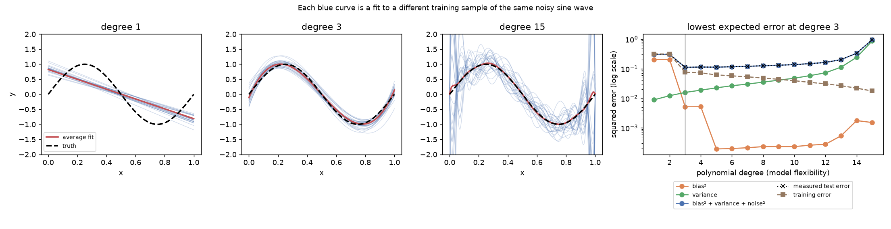

# Bias-variance, measured



Left three panels: the same noisy sine wave sampled 300 times (20 points each, same x values, fresh
noise), with a polynomial of degree 1, 3 and 15 fitted to every sample. Each blue line is one fit; the
red line is their average; the dashed line is the truth. Right panel: the three parts of expected error
for degrees 1 to 15.

```
python bias_variance.py        # prints the table and rewrites bias_variance.png
```

## Reading it

| degree | what the left panels show | bias² | variance |
|---|---|---|---|
| 1 | every fit is nearly the same straight line, all of them wrong | 0.205 | 0.009 |
| 3 | fits cluster around the sine | 0.005 | 0.016 |
| 15 | the average is right, but single fits swing wildly, especially at the ends | 0.002 | 0.870 |

- **Underfitting is bias.** A line cannot follow a sine, however much data it sees: averaging 300 fits does not help.
- **Overfitting is variance.** At degree 15 the *average* curve is accurate, but any single fit is mostly noise. Training error keeps falling with every added degree while test error rises, which is why training error cannot choose the model.
- **The noise floor (0.09) never moves.** Even the best model here (degree 3, expected error 0.111) is above it.

## What is verified

The tests check that bias² + variance + noise² agrees with test error measured separately on fresh
noisy targets (within 5%), that variance follows the least-squares result σ²(d+1)/n for low degrees,
that training error never rises with degree, and that the best degree is in the middle.

## Limits and choices

- **Fixed x values.** An earlier version drew random x values for every sample; high-degree fits then had to extrapolate past the data and test error exploded to ~40,000, which says more about empty edges than about flexibility. Fixing the design isolates what is being demonstrated.
- **Degree 2 is no better than degree 1.** A full sine period has no quadratic component, so bias only drops at degree 3. This is real, not a bug.
- It is a toy problem with a known truth, which real data never gives you; on real data these terms are estimated indirectly, through cross-validation.
