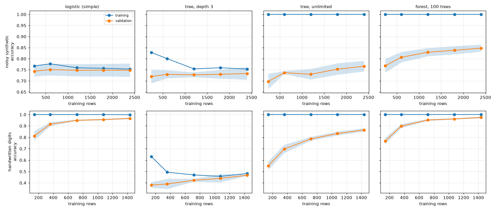

# Learning curves: bias, variance, and whether more data would help

Trains the same model on 10%, 25%, 50%, 75% and 100% of the training rows and records accuracy on the rows it was
fitted to and on held-out rows (5-fold cross-validation). Four models on two datasets: a noisy synthetic problem with
a nonlinear boundary (3 clusters per class, 8% flipped labels) and the handwritten digits data.

```
python learning_curves.py     # prints the tables and writes learning_curves.png
pytest
```



## Results (accuracy at the full training slice)

| dataset | model | train | validation | gap | gain from last doubling | diagnosis |
|---|---|---|---|---|---|---|
| noisy synthetic | logistic | 0.753 | 0.748 | 0.005 | 0.000 | underfitting |
| noisy synthetic | tree, depth 3 | 0.754 | 0.733 | 0.020 | 0.006 | underfitting |
| noisy synthetic | tree, unlimited | 1.000 | 0.766 | 0.234 | 0.036 | overfitting |
| noisy synthetic | forest, 100 trees | 1.000 | 0.848 | 0.152 | 0.018 | overfitting |
| digits | logistic | 0.999 | 0.966 | 0.033 | 0.017 | about right |
| digits | tree, depth 3 | 0.483 | 0.467 | 0.015 | 0.044 | underfitting |
| digits | tree, unlimited | 1.000 | 0.865 | 0.135 | 0.078 | overfitting |
| digits | forest, 100 trees | 1.000 | 0.974 | 0.026 | 0.022 | about right |

## What to take from it

* The two simple models on the noisy data show the high-bias signature: training and validation scores sit together
  near 0.75 and adding data changes nothing (logistic gain 0.000). More rows will not help; a more flexible model will.
* The unlimited tree shows high variance: training accuracy 1.000, validation 0.766, and its validation curve is still
  rising. More data helps it, but the forest on the same data is already far ahead (0.848).
* **A large gap does not mean the model is bad.** The forest on the noisy data is labelled "overfitting" by the gap
  rule yet is the best validator in the table. Compare validation scores across models; use the gap only to decide
  what to try next (regularise, or collect data).
* "Gain from last doubling" is the validation gain from half the training slice to the full slice. It says what more
  data would do over a small range; it is not a forecast far beyond the data we have.

## Limits

* The diagnosis labels come from two thresholds (gap above 0.08; validation 0.03 below the best model) that are rules
  of thumb, not tests. Change them and a few labels move.
* One seed, 5 folds; shaded bands in the figure are the fold standard deviation. Differences of about 0.01 are noise.
* Accuracy on balanced classes only; for imbalanced problems use PR-AUC and see the class-imbalance lab.
