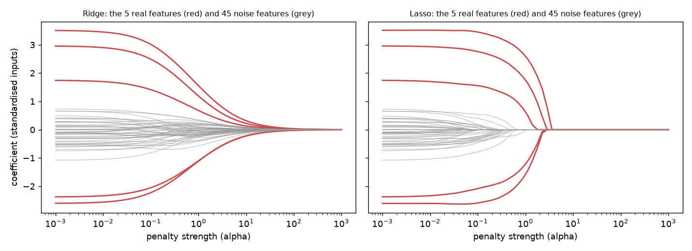

# Regularization: Ridge versus Lasso

Both add a penalty on coefficient size to least squares. **Ridge** (L2) shrinks every coefficient toward zero but
keeps all of them; **Lasso** (L1) pushes some to exactly zero, so it also selects features. Which predicts better
depends on what is true, so this lab builds two worlds where the truth is known, then tries real data
(`python regularization.py`, about 10 seconds). The penalty strength is chosen by cross-validation inside the
training data, and features are standardised inside the pipeline.

## Results

100 training rows, 50 features, noise standard deviation 3, averaged over 30 fresh datasets. Test error is measured on
5,000 fresh rows and shown as a multiple of the irreducible noise variance (1.00 would be a perfect model).

| truth | OLS error | Ridge error | Lasso error | best coefficient recovery |
|---|---|---|---|---|
| **sparse**: 5 large coefficients, 45 exactly zero | 2.08 | 1.77 | **1.23** | Lasso (error 1.35 vs 2.57 for Ridge, 3.04 for OLS) |
| **dense**: all 50 small, none zero | 1.99 | **1.58** | 1.70 | Ridge (2.25 vs 2.47 for Lasso) |
| **correlated**: 5 real features, each with 4 near-copies (correlation about 0.9) | 2.06 | 1.35 | **1.20** (elastic net 1.22) | Lasso (2.87 vs 4.55 for Ridge, 8.81 for OLS) |

- **Sparse world:** Lasso found all 5 real features every time, zeroed about 34 coefficients, but still kept about 11 of the 45 noise features. It selects well, not cleanly.
- **Dense world:** Lasso zeroed about 14 coefficients that all matter, which is why Ridge beats it.
- **Correlated world:** prediction is as good as ever, and Lasso always finds the right *group* of columns, but it picks the real column on its own, with none of its copies alongside, only 22% of the time (it keeps 6.3 of the 20 copies, against 5.1 of 20 independent noise columns in the sparse world). So the selected list is a good place to look for signal, not a list of which columns matter. Elastic net, a mix of both penalties, predicts about as well.
- **Real data, diabetes progression (442 patients, 10 measurements):** mean squared error 2,992 (OLS), 3,003 (Ridge), 3,004 (Lasso). All three are within 0.5% of each other. With many more rows than features there is little to shrink, so regularization is not a free win.
- **The penalty is not scale-free.** Two equally useful features, one in thousands and one in fractions: unscaled Lasso kept one feature and dropped the small-unit one, standardised Lasso kept both. Standardise inside the pipeline so each fold learns its own scaling.

## What to take from it

Regularization pays when features are many relative to rows (here 50 features on 100 rows, where plain least squares
roughly doubles the error). Choose Lasso when you believe few features matter or you want a short list, Ridge when many
matter a little, and expect either to change little when rows greatly outnumber features.

## Limits

Gaussian features and noise, one signal strength per world, and alpha chosen by 5-fold cross-validation with default
grids. The correlated world uses one correlation level (about 0.9) and equal-sized groups; stronger or weaker
correlation would shift the numbers. The real-data comparison is a single small dataset.
